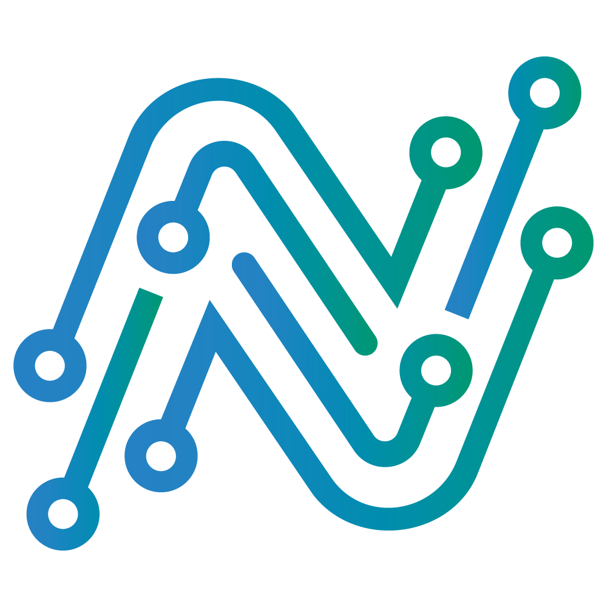

<p align="left">
  
</p>

# nexthemis

**Echtzeit-Systemwächter und Transparenz-Audit für KI- und Agent-Aktivitäten unter Windows.**

`nexthemis` ist ein leichtgewichtiges Hintergrund-Werkzeug für Windows 11, das das lokale System kontinuierlich auf unbemerkte KI-Zugriffe, versteckte Kommunikations-Logs und Hintergrund-Agenten überwacht. Sobald eine Software im Hintergrund KI-Suchen durchführt, Vektordatenbanken anlegt oder bekannte KI-Schnittstellen kontaktiert, schlägt `nexthemis` sofort per Desktop-Benachrichtigung Alarm und protokolliert den Vorfall nachvollziehbar.

Ein Open-Source-Projekt von **nextfield** ([www.nextfield.de](https://www.nextfield.de)).

---

## 🚀 Download-Counter
<div align="left">

[](https://github.com/nextfield/nexthemis/releases)
[](https://github.com/nextfield/nexthemis/releases/latest)

</div>

*Entwickelt als Teil der **nextfield**-Infrastruktur.*

---

## Kernfunktionen

* **Echtzeit-Dateisystem-Überwachung (`watchdog`):** Überwacht relevante Benutzer- und AppData-Verzeichnisse ereignisbasiert über das Windows-Dateisystem auf neu erstellte oder beschriebene KI-Logs (`.log`, `.json`, `.jsonl`) sowie lokale Vektor-Speicher (`.sqlite`, `.sqlite3`, `.db`).
* **Payload- & Log-Inspektion:** Erkennt typische Kommunikations- und Suchmuster innerhalb von Log-Dateien (u. a. `system_prompt`, `tool_calls`, `embeddings`, `vector_search`, `rag_query` sowie API-Endpunkte wie `api.openai.com`, `api.anthropic.com` oder `localhost:11434`).
* **Prozess- & Port-Monitor (`psutil`):** Prüft Hintergrundprozesse auf bekannte Agent-Signaturen und überwacht aktive Netzwerkverbindungen zu lokalen Inferenz-Ports (`11434`, `1234`, `5000`, `8000`, `8080`).
* **Unauffälliger System-Tray-Betrieb:** Läuft ohne störendes Konsolenfenster im Windows-System-Tray und protokolliert alle erkannten Ereignisse mit Zeitstempel unter `~/.nexthemis/nexthemis_alerts.log`.
* **Integriertes Whitelisting:** Eigene, bewusst betriebene lokale KI-Systeme (z. B. `nexthron`) lassen sich direkt in der Konfiguration von Warnmeldungen ausnehmen.

---

## Projektstruktur

```text
nexthemis/
├── nexthemis.py       # Hauptprogramm (Echtzeit-Scanner, Prozess-Monitor & System-Tray)
├── requirements.txt   # Benötigte Python-Abhängigkeiten
├── README.md          # Projektdokumentation
├── LICENSE            # MIT-Lizenz
└── .gitignore         # Ausschluss lokaler Build-Artefakte und Audit-Logs
